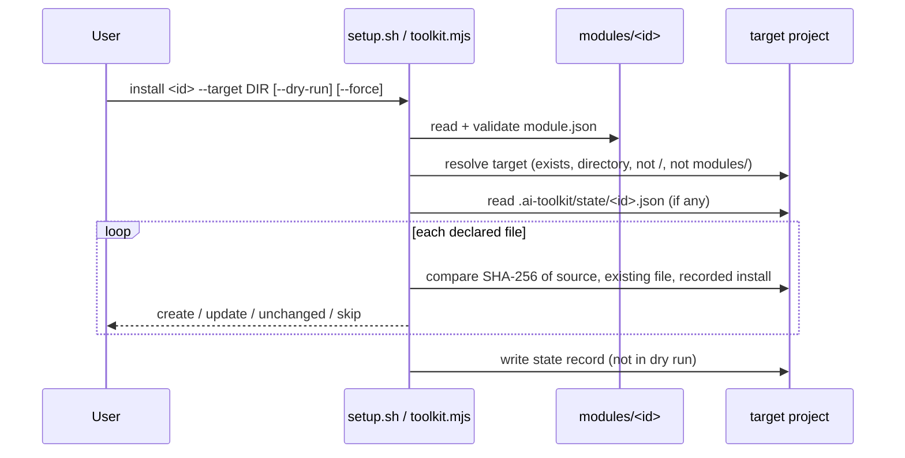

# Architecture

This document explains how AI Toolkit is organised and why. Decisions with
lasting impact are recorded in [docs/decisions/](docs/decisions/README.md).

## Why a modular monorepo

The toolkit collects unrelated automations (SEO checks, catalog validation,
Claude Code assets) that share conventions but not code. A monorepo gives one
place for conventions, CI, templates and the installer. Independent modules
keep each automation small, separately versioned and usable on its own.

Consequences:

- Modules do not import each other. Shared behaviour is a convention or a
  template, not a library.
- Each module has its own version and changelog. The repository has its own
  version for the installer, templates and docs.
- There is no build system. Modules run from source.

See [ADR 0001](docs/decisions/0001-modular-monorepo.md).

## Repository layout

```text
ai-toolkit/
├── modules/<id>/          independent modules (module.json, README.md, CHANGELOG.md, ...)
├── templates/             module, agent, skill and workflow templates
├── scripts/
│   ├── setup.sh           central CLI (bash wrapper)
│   ├── install-module.sh  shortcut: setup.sh install
│   ├── update-module.sh   shortcut: setup.sh update
│   ├── new-module.sh      shortcut: setup.sh new
│   ├── validate-repo.sh   all repository checks
│   └── lib/
│       ├── common.sh      shared shell helpers
│       ├── toolkit.mjs    CLI implementation (manifest validation, installer)
│       └── check-links.mjs  Markdown link checker
├── tests/
│   ├── scripts/           installer tests
│   └── fixtures/modules/  fixture modules (valid, invalid, unsafe)
├── docs/                  guides, decisions, reference
└── examples/              cross-module walkthroughs
```

## Module contract

A directory under `modules/` is a module if it contains `module.json`. It must
also contain:

| File | Purpose |
| --- | --- |
| `module.json` | Machine-readable manifest ([reference](docs/module-manifest.md)) |
| `README.md` | User documentation with the required sections below |
| `CHANGELOG.md` | Module change history (Keep a Changelog) |

Required README sections (`##` headings, checked by `setup.sh validate`):
Purpose, Status, Prerequisites, Installation, Usage, Inputs and outputs,
Permissions and side effects, Testing, Uninstall, Limitations,
Troubleshooting, Compatibility.

Everything else (`src/`, `tests/`, `examples/`, `claude/`, `config/`,
`templates/`, `scripts/`) is optional and used only when relevant.

**Deviation from the original brief:** there is no separate `MODULE.md`. The
contract details it would hold (inputs, outputs, permissions) are required
README sections, which avoids two documents drifting apart.

## Module discovery

`setup.sh` lists the directories in `modules/` (or `$AI_TOOLKIT_MODULES_DIR`,
used by tests) that contain `module.json`, sorted by name. There is no
registry file to keep in sync. Invalid modules still appear in `list` as
`INVALID` so they are not silently hidden.

## Manifest

The manifest is deliberately small and strict:

- Unknown top-level fields are errors. This catches typos and makes it
  impossible to smuggle in fields such as `postinstall`.
- There are no command fields. `tests` names a directory; the CLI runs
  `node --test` on `*.test.mjs` files in it with a fixed argument list.
- Every path is relative, normalised, free of `..` and must exist (sources,
  entry points, tests). Symlinks are rejected.

Full reference: [docs/module-manifest.md](docs/module-manifest.md).

## Installation model



Per file:

| Target file | Without `--force` | With `--force` |
| --- | --- | --- |
| Missing | create | create |
| Identical to source | unchanged | unchanged |
| Installed by the toolkit and unmodified since | update | update |
| Different and not owned, or edited locally | **skip** | overwrite |

`update` uses the same rules but requires an existing install record.
`uninstall` deletes only files whose checksum still matches the record, then
removes directories left empty. It never deletes edited files and has no
`--force`.

Before each write, the CLI resolves the real path of the parent directory and
refuses to write if a symlink would lead outside the target, or if the
destination itself is a symlink.

The installer never edits shared configuration files such as
`.claude/settings.json`; modules ship examples and document the manual merge.

Why the core is Node rather than pure bash: JSON parsing, checksums and path
normalisation are error-prone in bash 3.2 (the macOS default), and Node is
already required by the modules. `setup.sh` remains the documented interface.
See [ADR 0002](docs/decisions/0002-node-installer-core.md) and
[ADR 0003](docs/decisions/0003-checksum-ownership.md).

## Templates

`templates/module-template/` is copied by `setup.sh new`, replacing
`{{MODULE_ID}}`, `{{MODULE_NAME}}`, `{{MODULE_DESCRIPTION}}` and `{{DATE}}`.
A freshly generated module passes `validate` and its own tests, which the
installer tests verify. Agent, skill and workflow templates are copied by hand;
their READMEs explain how.

## Tests

| Layer | Location | Runner |
| --- | --- | --- |
| Installer and manifest validation | `tests/scripts/` | `node --test` |
| Module logic and CLIs | `modules/<id>/tests/` | `node --test` |
| Shell scripts | all `*.sh` | `bash -n`, ShellCheck |
| Docs | all `*.md` | markdownlint, link checker |

Installer tests run against fixture modules in temporary directories. They
cover listing, unknown and invalid modules, unsafe paths, repeated installs,
preserving existing files, `--force`, `--dry-run`, invalid targets, symlink
escapes, update, uninstall, corrupt state and scaffolding.

`scripts/validate-repo.sh` runs everything; CI runs it with
`AI_TOOLKIT_STRICT=1` on Ubuntu so missing linters fail the build.

## Trust boundaries

| Boundary | Trusted? | Controls |
| --- | --- | --- |
| Module manifests | Untrusted data | Strict schema, no commands, path validation |
| Module files copied into a project | Reviewed in PRs | Dry run, no overwrite, ownership records |
| Target directory | User-chosen | Must exist; symlink escape checks |
| Install state files | Untrusted data | Shape and path validation; corrupt state is an error |
| Input files to module CLIs | Untrusted data | Parsed, never executed; read-only |
| Claude Code skills/agents | Prompts | Least-privilege tool lists; checkpoints for side effects |

See [docs/security.md](docs/security.md).

## Integrating future modules

1. Scaffold with `./scripts/new-module.sh <id> --name "..."`.
2. Keep the module self-contained; do not import from other modules.
3. Declare every installed file in `install.files`; never modify shared
   configuration automatically.
4. Prefer deterministic code for checks; put AI judgment in skills or agents
   and label it.
5. Add tests under the module's `tests/` and update the root README catalog,
   ROADMAP and CHANGELOG.
