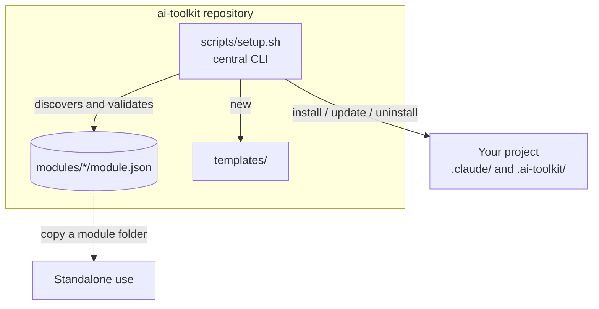

# AI Toolkit

> One toolkit. Independent automations. Infinite possibilities.

AI Toolkit is a modular monorepo of reusable automations for AI-assisted
software development: Claude Code skills, agents and hooks, deterministic
quality gates, and small zero-dependency CLIs for SEO, e-commerce data and
daily workflows. Each module is independent. Use one, several or all of them,
inside the toolkit or copied into your own projects.

## Contents

- [Key capabilities](#key-capabilities)
- [Architecture overview](#architecture-overview)
- [Module catalog](#module-catalog)
- [Requirements](#requirements)
- [Quick start](#quick-start)
- [Installing modules](#installing-modules)
- [Usage examples](#usage-examples)
- [Security and permissions](#security-and-permissions)
- [Adding a module](#adding-a-module)
- [Testing and validation](#testing-and-validation)
- [Contributing](#contributing)
- [Roadmap](#roadmap)
- [License](#license)
- [Limitations and support](#limitations-and-support)

## Key capabilities

- **Independent modules** with a small, validated manifest (`module.json`).
- **Safe central installer**: dry runs, no silent overwrites, checksum-based
  ownership for update and uninstall, and nothing from a manifest is ever
  executed.
- **Deterministic gates first, AI second**: ticket readiness, OpenAPI
  breaking changes, catalog validation and technical SEO checks are plain code
  with exit codes. AI assets (skills, agents) build on top of them.
- **Claude Code assets** that follow the documented skill, subagent and hook
  formats, with tests for the hooks.
- **Templates** for new modules, agents, skills and workflows, plus a
  scaffolding command.

## Architecture overview



- `modules/<id>/` holds one self-contained module.
- `scripts/setup.sh` discovers modules by scanning for `module.json`,
  validates them, and copies declared files into a project.
- Installed files are recorded with SHA-256 checksums in
  `<project>/.ai-toolkit/state/<id>.json`, so updates never clobber local
  edits.

Details: [ARCHITECTURE.md](ARCHITECTURE.md).

## Module catalog

Status labels: **Stable** (API frozen within a major version), **Experimental**
(implemented and tested, may change), **Planned**, **Not implemented**.

| Module | Status | What it does | Runtime |
| --- | --- | --- | --- |
| [harness-engineering](modules/harness-engineering/README.md) | Experimental | Ticket readiness gate, OpenAPI breaking-change gate, requirements and review subagents, gated workflow skill | Node 22+, Claude Code |
| [daily-automation](modules/daily-automation/README.md) | Experimental | Daily engineering summary from a task file; opt-in launchd example | Node 22+ |
| [ecommerce-automation](modules/ecommerce-automation/README.md) | Experimental | Catalog and inventory validation (SKUs, prices, GTINs, variants, stock) | Node 22+ |
| [seo-automation](modules/seo-automation/README.md) | Experimental | Metadata, canonical, robots.txt, sitemap and JSON-LD checks; labelled AEO/GEO heuristics | Node 22+ |
| [claude-code-toolkit](modules/claude-code-toolkit/README.md) | Experimental | Skills, subagents, safety hooks, notification hook, CLAUDE.md template | Claude Code, bash, jq |

No module is labelled Stable yet: all are at 0.1.0. Every module README lists
which capabilities are implemented and which are not.

## Requirements

| Tool | Version | Needed for |
| --- | --- | --- |
| macOS or Linux | macOS is the primary platform | everything |
| Node.js | 22 or later | installer, CLIs, tests |
| bash | 3.2 or later (macOS default works) | scripts |
| jq | 1.6 or later | Claude Code hooks only |
| Claude Code | 2.x | skills, agents, hooks |
| npm | bundled with Node | dev tooling (markdownlint) only |
| ShellCheck | any recent | shell linting (optional locally) |

No module has runtime npm dependencies. `npm ci` only installs the pinned
Markdown linter.

## Quick start

```bash
git clone <your-fork-or-repo-url> ai-toolkit
cd ai-toolkit
npm ci                      # dev tooling only
./scripts/setup.sh list     # see modules
./scripts/validate-repo.sh  # run every check
```

## Installing modules

The central CLI copies a module's declared files into a project directory you
name explicitly.

```bash
./scripts/setup.sh info claude-code-toolkit
./scripts/setup.sh install claude-code-toolkit --target ~/code/my-app --dry-run
./scripts/setup.sh install claude-code-toolkit --target ~/code/my-app
./scripts/setup.sh status --target ~/code/my-app
./scripts/setup.sh update claude-code-toolkit --target ~/code/my-app
./scripts/setup.sh uninstall claude-code-toolkit --target ~/code/my-app
```

| Command | Purpose |
| --- | --- |
| `list [--json]` | List modules |
| `info <module> [--json]` | Show manifest details |
| `validate [<module>]` | Validate manifests and required docs |
| `test <module>` | Run a module's tests |
| `install <module> --target DIR` | Copy files; existing different files are skipped |
| `update <module> --target DIR` | Refresh files the toolkit installed and you have not edited |
| `uninstall <module> --target DIR` | Remove installed files you have not edited |
| `status --target DIR` | Show installed modules |
| `new <module> --name "Name"` | Scaffold a module from the template |

Options: `--dry-run`, `--force` (install/update only), `--json`. Aliases
`--list`, `--info <m>` and `--module <m>` are accepted.
`scripts/install-module.sh` and `scripts/update-module.sh` are shortcuts.

**Standalone:** every module also works without the installer. Copy its
folder and follow its README. Full guide: [docs/installation.md](docs/installation.md).

## Usage examples

```bash
# Ticket readiness gate (exit 1 = not ready)
node modules/harness-engineering/src/cli.mjs ticket modules/harness-engineering/examples/ticket-ready.md

# OpenAPI breaking-change gate
node modules/harness-engineering/src/cli.mjs contract \
  modules/harness-engineering/examples/openapi-v1.json \
  modules/harness-engineering/examples/openapi-v2-breaking.json

# Technical SEO checks on a local HTML file
node modules/seo-automation/src/cli.mjs page modules/seo-automation/examples/bad-page.html

# Catalog validation
node modules/ecommerce-automation/src/validate-catalog.mjs \
  --catalog modules/ecommerce-automation/examples/products.sample.json \
  --inventory modules/ecommerce-automation/examples/inventory.sample.json

# Daily summary
node modules/daily-automation/src/daily-summary.mjs \
  --input modules/daily-automation/examples/tasks.json --date 2026-10-10
```

More walkthroughs: [examples/README.md](examples/README.md).

## Security and permissions

- Manifests are data. The installer never runs commands from a manifest and
  rejects unknown fields, absolute paths, `..`, symlinks, and writes into
  `.git` or its own state directory.
- No module makes network requests, sends notifications to third-party
  services, or schedules background jobs. The only notification is a local
  macOS banner from an opt-in Claude Code hook.
- All sample data is synthetic. No real credentials are needed or stored.
- The Claude Code safety hooks are guardrails, not a sandbox.

Read [SECURITY.md](SECURITY.md) to report a vulnerability and
[docs/security.md](docs/security.md) for the threat model.

## Adding a module

```bash
./scripts/new-module.sh release-notes --name "Release Notes" --description "Drafts release notes from merged PRs."
./scripts/setup.sh validate release-notes
./scripts/setup.sh test release-notes
```

Then fill in the generated README and manifest. See
[docs/module-development.md](docs/module-development.md) and the walkthrough in
[docs/guides/creating-a-module.md](docs/guides/creating-a-module.md).

## Testing and validation

```bash
npm run validate          # everything below, in one command
npm test                  # unit tests (node:test)
npm run validate:modules  # manifests and required README sections
npm run lint:md           # markdownlint
npm run lint:sh           # ShellCheck
npm run check:links       # relative Markdown links and anchors
```

CI ([.github/workflows/ci.yml](.github/workflows/ci.yml)) runs
`scripts/validate-repo.sh` on Ubuntu (Node 22 and 24) and macOS (Node 24).

## Contributing

Contributions are welcome. Read [CONTRIBUTING.md](CONTRIBUTING.md) and the
[Code of Conduct](CODE_OF_CONDUCT.md). AI coding agents working in this
repository should read [AGENTS.md](AGENTS.md).

## Roadmap

See [ROADMAP.md](ROADMAP.md) for what is implemented, in progress and planned,
and [CHANGELOG.md](CHANGELOG.md) for released changes.

## License

[MIT](LICENSE). See [docs/decisions/0004-license.md](docs/decisions/0004-license.md)
for why.

## Limitations and support

- All modules are experimental (0.1.0). Interfaces may change before 1.0.
- Checks are deterministic but intentionally narrow; each module README has a
  Limitations section.
- macOS and Linux only. Windows is untested.

Questions and help: [SUPPORT.md](SUPPORT.md). Common problems:
[docs/troubleshooting.md](docs/troubleshooting.md) and [docs/faq.md](docs/faq.md).
