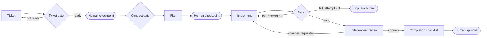

# Harness Engineering

A gated, human-supervised workflow for AI-assisted software delivery. The
"harness" is the set of deterministic checks and checkpoints around the AI:
the AI does the work, the harness decides whether the work may move forward.

## Purpose

Make AI-assisted changes predictable by enforcing the same lifecycle on every
ticket:



Supported use cases:

- Rejecting vague tickets before implementation starts.
- Catching OpenAPI breaking changes in a pull request.
- Running a Claude Code session through planned, reviewed, tested steps.

## Status

**Experimental (0.1.0).** Be precise about what is code and what is guidance:

| Capability | Status | Enforced by |
| --- | --- | --- |
| Ticket readiness gate (`ticket`) | Implemented, tested | Code (exit code) |
| OpenAPI breaking-change gate (`contract`) | Implemented, tested | Code (exit code) |
| Requirements analyst subagent | Implemented | Prompt instructions |
| Independent reviewer subagent | Implemented | Prompt instructions |
| Workflow skill with checkpoints | Implemented | Prompt instructions |
| 3-attempt fix-and-retest limit | Implemented | Prompt instructions, not code |
| Autonomous end-to-end pipeline | **Not implemented** | - |
| CI integration of the gates | Documented below; you add the workflow step | - |

The subagents and skill rely on Claude following instructions. They are not a
sandbox. The two CLI gates are deterministic and suitable for CI.

## Prerequisites

- Node.js 22 or later (CLI gates). No npm packages.
- Claude Code (for the agents and skill). Version used while writing:
  2.1.x. Skills and subagents are read from `.claude/skills/` and
  `.claude/agents/` in the project.

## Installation

```bash
./scripts/setup.sh install harness-engineering --target ~/code/my-service --dry-run
./scripts/setup.sh install harness-engineering --target ~/code/my-service
```

Installed files:

| Source | Target |
| --- | --- |
| `src/` | `.ai-toolkit/modules/harness-engineering/src/` |
| `templates/` | `.ai-toolkit/modules/harness-engineering/templates/` |
| `claude/agents/*.md` | `.claude/agents/` |
| `claude/skills/harness-workflow/` | `.claude/skills/harness-workflow/` |

Standalone: the CLI runs from a plain copy of `src/`. To use only the Claude
Code pieces, copy `claude/agents/*.md` and `claude/skills/harness-workflow/`
into your project's `.claude/` directory.

## Usage

CLI gates, from `modules/harness-engineering/`:

```bash
node src/cli.mjs ticket examples/ticket-ready.md         # exit 0, READY
node src/cli.mjs ticket examples/ticket-not-ready.md     # exit 1, NOT READY
node src/cli.mjs contract examples/openapi-v1.json examples/openapi-v2-compatible.json  # exit 0
node src/cli.mjs contract examples/openapi-v1.json examples/openapi-v2-breaking.json    # exit 1
```

In Claude Code, after installing into a project:

```text
/harness-workflow docs/tickets/ENG-142.md
```

The skill has `disable-model-invocation: true`, so it only runs when you
invoke it. The subagents can also be used directly, for example "use the
independent-reviewer agent to review this branch against ENG-142.md".

### Example: contract gate in CI

```yaml
- name: API contract gate
  run: |
    git show origin/main:openapi.json > /tmp/openapi-base.json
    node .ai-toolkit/modules/harness-engineering/src/cli.mjs contract /tmp/openapi-base.json openapi.json
```

## Inputs and outputs

| Command | Input | Pass (exit 0) | Fail (exit 1) |
| --- | --- | --- | --- |
| `ticket <file.md>` | Markdown ticket (see `templates/ticket.md`) | READY | Missing sections, non-checklist criteria, `TBD`/`TODO`/`FIXME` |
| `contract <old.json> <new.json>` | OpenAPI 3.x JSON | No breaking changes | Removed path/operation/parameter/2xx response or response property; new required parameter or request property; body became required |

`--json` prints machine-readable results. Exit code `2` means a usage error or
unreadable input.

Ticket rules: `## Summary`, `## Acceptance Criteria` (as `- [ ]` items) and
`## Test Plan` are required; `## Out of Scope` and `## Risks` are recommended.
Vague words such as "fast" or "properly" in criteria produce warnings.

## Permissions and side effects

- CLI: reads the files you pass. Writes nothing. No network.
- Subagents: `Read, Grep, Glob, Bash`. Bash is limited by instruction to
  read-only git commands, the harness CLI and the project's test command.
  Use Claude Code permission rules if you need hard enforcement.
- Skill: drives Claude to edit code and run tests, with three human
  checkpoints. It never commits or pushes unless you ask.

## Testing

```bash
./scripts/setup.sh test harness-engineering
```

## Uninstall

```bash
./scripts/setup.sh uninstall harness-engineering --target ~/code/my-service
```

Agent or skill files you edited after installation are kept.

## Limitations

- Ticket validation checks structure and wording, not whether requirements
  are correct.
- Contract checks: JSON only (convert YAML with `yq -o=json`), local `$ref`s
  only, top-level properties of request/response schemas only, no
  `oneOf`/`anyOf` analysis, no enum narrowing or type changes.
- The fix-loop limit and checkpoints are instructions to Claude, not enforced
  by code.

## Troubleshooting

| Symptom | Fix |
| --- | --- |
| `is not valid JSON (YAML is not supported)` | Convert the spec: `yq -o=json openapi.yaml > openapi.json`. |
| `/harness-workflow` not found | Check `.claude/skills/harness-workflow/SKILL.md` exists in the project and restart Claude Code. |
| Ticket fails on `placeholder` | Replace every `TBD`/`TODO` with a decision or move it to `## Risks` as a question. |

## Compatibility

- CLI: Node.js 22+ on macOS and Linux.
- Claude Code assets: skills and subagents format as documented at
  <https://code.claude.com/docs>. Manifest: `module.json` (schema v1).
